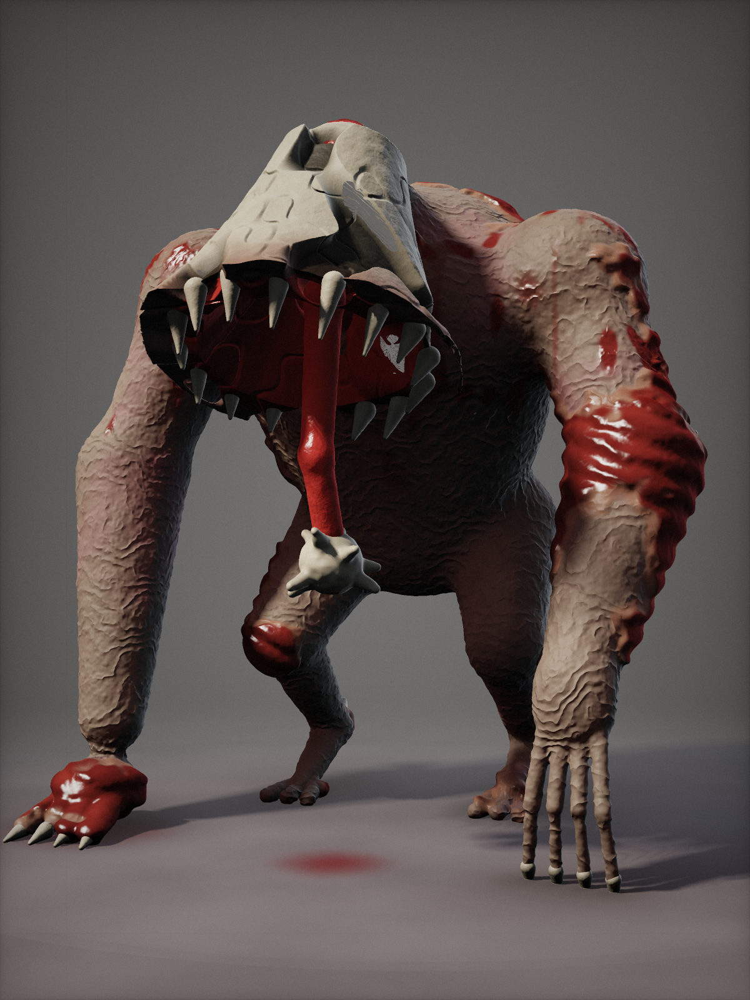

# KLÖPPEL

**Kernidee:** Ein massiver, gebeugter Koloss ohne Kopf. Auf einem vorgeschobenen Stiernacken sitzt eine **Glocke aus verschmolzenen Schädeln**. Aus ihrem Inneren hängt eine lange, nasse Zunge mit einem **Knoten aus menschlichen Zähnen** als Klöppel.

## Signature Feature
**Es läutet.** Bei jedem schweren Schritt schlägt der Zahnknoten gegen die Knocheninnenwand: ein dumpfer, hohler, leicht verstimmter Glockenschlag. Je schneller es jagt, desto schneller läutet es. Zum Töten stülpt es die Glocke über das Opfer, und der Rand aus Kieferzähnen schließt sich.

## Silhouette & Proportionen
- ca. 2,4 m gebeugt, Schulterbreite ca. 1,6 m, Gewicht schwer
- extrem lange, massige Arme (Knöchelgang). Ein Arm ist aufgestützt, der andere hängt mit überlangen Fingern nach vorn.
- kurze, digitigrade Beine mit Fersensporn
- die Glocke als klar lesbare Kopfform: oben schmal, unten offen, Zahnkranz am Rand

## Anatomie
- **Glocke:** verschmolzene Schädelplatten mit Nähten und leeren Augenhöhlen. Innen nasses, rotes Fleisch, am Rand 16 Zähne in unterschiedlicher Länge.
- **Rücken:** Wirbelsäule bricht durch die Haut, die Dornfortsätze stehen als Stacheln heraus.
- **Haut:** fahl, faltig, mit Hämatomen. Stellenweise **abgezogen**, sodass gestreiftes Muskelgewebe zu sehen ist.
- **Brust:** freiliegendes Schlüsselbein und Rippen auf der linken Seite; Blut läuft vom Glockenrand über die Brust.
- Knochensporne an den Ellbogen, schwarze Krallen.

## Farbpalette
| Zone | Hex |
|---|---|
| Haut | `#3B382E` – `#625C4B` |
| Hämatome | `#4D2B33` |
| Muskel | `#2A0705` – `#5C120E` |
| Knochen/Schädel | `#9A8A6A` – `#C9BC9A` |
| Blut (getrocknet) | `#240404` |
| Nasses Fleisch | `#8C1A14` |

## Bewegung, Geräusch, Verhalten
- **Bewegung:** schwerer Knöchelgang, die Glocke pendelt bei jedem Schritt nach.
- **Geräusch:** Glockenschlag pro Schritt; im Stillstand ein leises Zahnklappern, wenn die Zunge zittert.
- **Verhalten:** Es hört schlecht, denn die Glocke dröhnt in seinem eigenen „Kopf“, aber es spürt Vibrationen. Wer still steht, während das Läuten näher kommt, hat eine Chance.

## Dateien
- `kloeppel_concept.png` – Concept-Render 1200×1600
- `kloeppel_render.html` – Quelle (SDF-Raymarching-Shader). Die Primitiven-Koordinaten in Metern dienen als Blockout-Vorlage für Blender.
