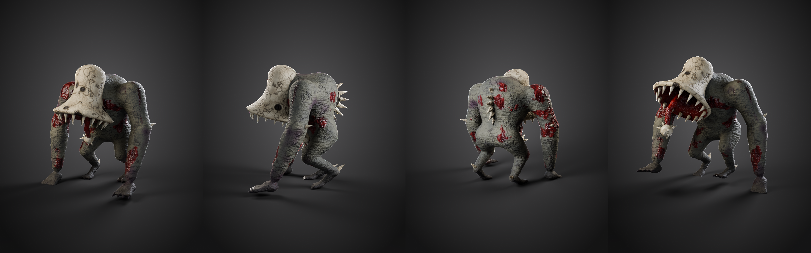

# KLÖPPEL – Roblox-Modell

Stilisierter Look, angelehnt an Roblox-Horror: klare Formen, Details aufgemalt statt modelliert, Schatten in die Textur eingebacken.

| | |
|---|---|
| Dreiecke | **10.124** (ein Mesh, Roblox-Limit pro MeshPart: 20.000) |
| Texturen | PBR-Set, je 1024×1024: **Color**, **Normal**, **Roughness** |
| Material | 1 (`Kloeppel_Mat`) → wird **ein** MeshPart |
| Rig | 21 Knochen, max. 4 Einflüsse pro Vertex |
| Animationen | `Idle` (60 Frames), `Walk` (36 Frames, Schleife), 30 fps |
| Größe | 2,4 m ≈ **8,6 Studs** hoch |

## Dateien
- `kloeppel_roblox.fbx` – **für Roblox Studio** (Mesh + Rig + Animationen + Textur eingebettet)
- `kloeppel_roblox.glb` – Alternative (glTF, ebenfalls mit Rig, Animationen und Textur)
- `kloeppel_roblox.blend` – Blender-Datei zum Weiterbearbeiten (Textur liegt daneben)
- `kloeppel_texture.png` – **ColorMap** (Farbe mit eingebackenen, gemalten Schatten)
- `kloeppel_normal.png` – **NormalMap** (Hautfalten, Poren, Adern, Muskelfasern, Knochenrisse, Augenhöhlen)
- `kloeppel_roughness.png` – **RoughnessMap** (Blut, Fleisch und Zunge nass glänzend, Haut und Knochen matt)
- `kloeppel_texture_maps.png` – Übersicht aller drei Maps
- `build_kloeppel.py` – erzeugt alles neu: `python build_kloeppel.py` (mit `pip install bpy`)
- `preview_*.png` – Vorschaubilder

## Knochen
`Root → Hips → Spine → Chest → Neck → Bell → Tongue1 → Tongue2 → Tongue3`
Arme: `Left/RightUpperArm → LowerArm → Hand` (an `Chest`)
Beine: `Left/RightUpperLeg → LowerLeg → Foot` (an `Hips`)

Die Glocke mit ihrem Zahnkranz hängt starr an `Bell`. Die Zunge ist auf drei Knochen verteilt und pendelt in beiden Animationen wie ein Klöppel.

## Import in Roblox Studio
1. **Home → Import 3D** und `kloeppel_roblox.fbx` wählen.
2. Im Import-Fenster prüfen, dass das Rig erkannt wird. Als Maßeinheit **Meter** wählen, damit das Modell ca. 8,6 Studs hoch ist.
3. **Texturen (SurfaceAppearance):** Falls der Importer sie nicht automatisch anlegt, im MeshPart ein **SurfaceAppearance**-Objekt einfügen und die drei PNGs hochladen:
   - `ColorMap` → `kloeppel_texture.png`
   - `NormalMap` → `kloeppel_normal.png`
   - `RoughnessMap` → `kloeppel_roughness.png`
   - `MetalnessMap` leer lassen (nichts an Klöppel ist metallisch).
4. **Animationen:** Model auswählen → **Animation Editor → ⋯ → Import → From FBX Animation** → `kloeppel_roblox.fbx`. `Idle` und `Walk` importieren, als Loop markieren und veröffentlichen.
5. Für einen NPC dem Model einen `Humanoid` oder `AnimationController` + `Animator` geben und die Animationen per Script abspielen.

> Hinweis: Das Modell wurde in Blender gebaut und der Export per Re-Import geprüft (FBX + GLB: Mesh, 21 Knochen, beide Animationen, Textur). In Roblox Studio selbst konnte es hier nicht getestet werden.

## Sound-Idee für Roblox
Bei jedem Schritt aus der `Walk`-Animation einen dumpfen, verstimmten Glockenschlag abspielen, z. B. mit einem Animation Event bei Frame 9 und 27.
