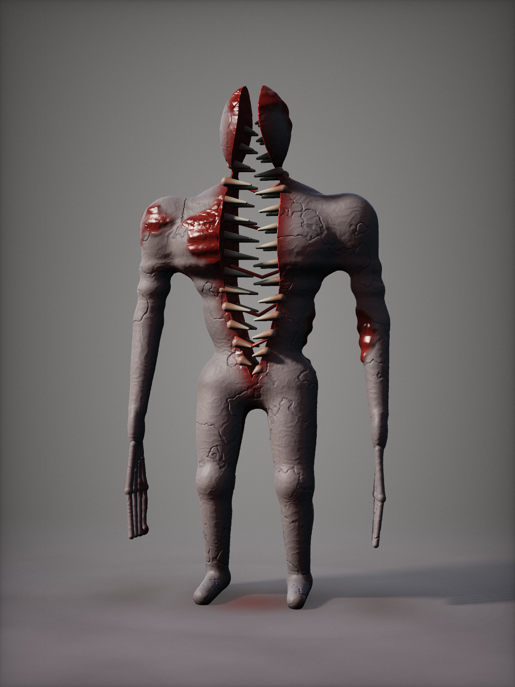

# DER SPALT

**Kernidee:** Eine große, aufrechte, fast menschliche Gestalt, die vom Scheitel bis zum Becken **senkrecht aufgerissen** ist. Die beiden Körperhälften stehen auseinander, und man kann durch sie hindurchsehen. Die Rissränder sind mit Zahnreihen besetzt. **Der ganze Körper ist ein Maul.**

## Signature Feature
**Die Silhouette mit Lichtschlitz.** Im Gegenlicht sieht man von der Gestalt nur einen dunklen Umriss, durch dessen Mitte ein senkrechter Streifen Licht fällt. Kein anderes Monster hat diese Form. Zum Angriff schließt sich der Riss um das Opfer wie ein senkrechter Kiefer, vom Kopf bis zur Hüfte.

## Silhouette & Proportionen
- ca. 2,5 m groß, aufrecht, breite Brust, schmale Hüfte
- Arme reichen bis zu den Knien, Hände mit überlangen, zweigliedrigen Fingern
- gesichtsloser Kopf, ebenfalls gespalten: zwei glatte Kopfhälften

## Anatomie
- **Riss:** innen nasses, gerilltes Fleisch, Speichelfäden spannen sich über den Spalt. Zwei versetzte Zahnreihen pro Seite greifen ineinander.
- **Haut:** fahles Blaugrau mit dunklen Adern, Rippen zeichnen sich ab. Stellenweise ist die Haut abgerissen und rotes Muskelgewebe liegt frei.
- Blut sickert an den Rissrändern herab und tropft zwischen den Beinen auf den Boden.

## Farbpalette
| Zone | Hex |
|---|---|
| Haut | `#21242A` – `#40424A` |
| Adern | `#12141F` |
| Rissfleisch | `#330505` – `#801410` |
| Zähne | `#807057` – `#B3A380` |
| Blut | `#210302` |

## Bewegung, Geräusch, Verhalten
- **Bewegung:** steht meist völlig still und aufrecht, ist dabei kaum von einer Person zu unterscheiden. Es geht langsam, mit steifen Knien. Beim Sprint klappen die beiden Hälften leicht auseinander und das Gangbild wird asynchron, als liefen zwei Körper.
- **Geräusch:** ein nasses, reißendes Ausatmen *durch den Spalt*, und das leise Klicken der Zähne, wenn sich der Riss beim Atmen schließt und öffnet.
- **Verhalten:** Es schaut nie direkt hin, denn es hat kein Gesicht, dreht aber den Spalt zum Spieler. Steht es im Türrahmen mit Licht dahinter, sieht man nur den Lichtschlitz.

## Dateien
- `spalt_concept.png` – Concept-Render 1200×1600
- `spalt_render.html` – Quelle (SDF-Raymarching-Shader), Maße in Metern als Blockout-Vorlage
